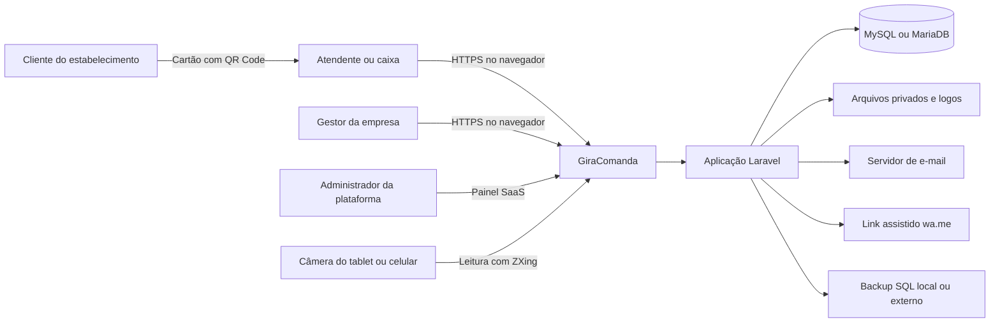
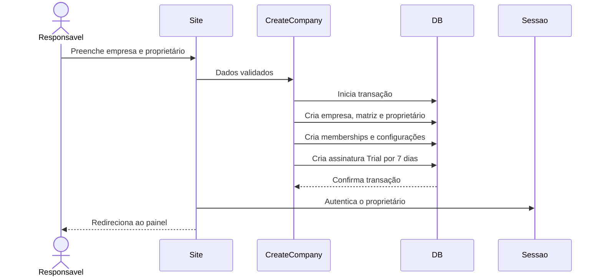
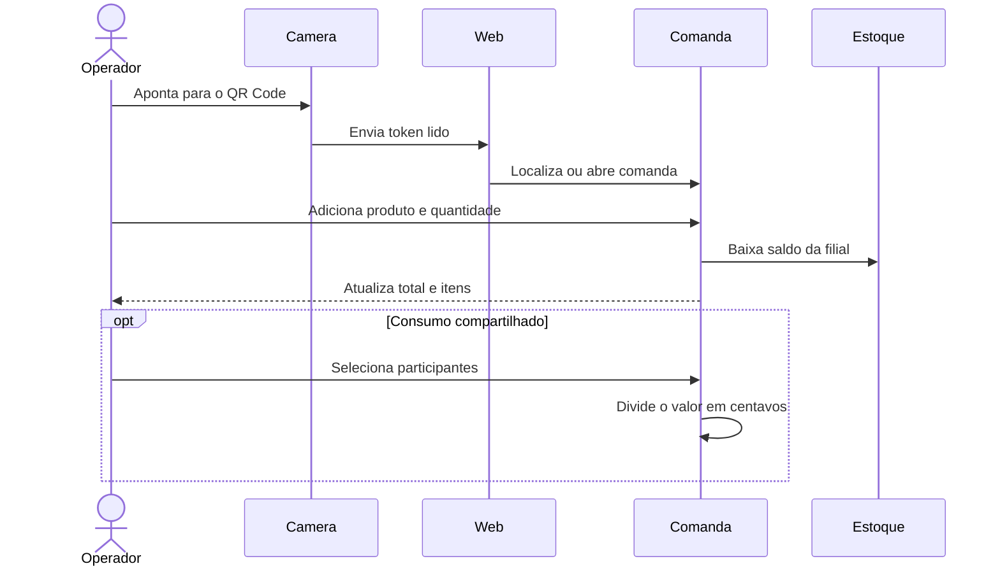
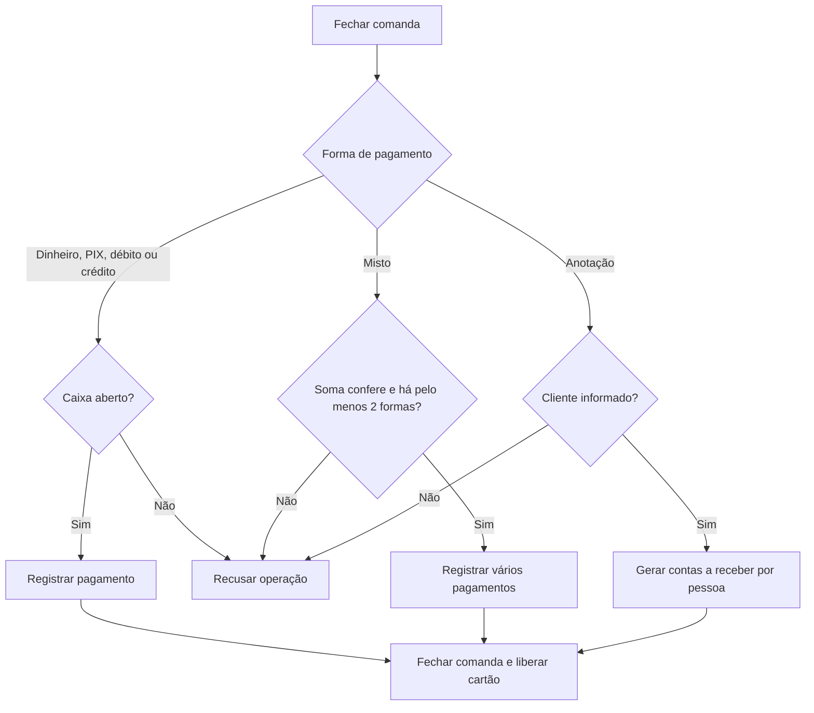
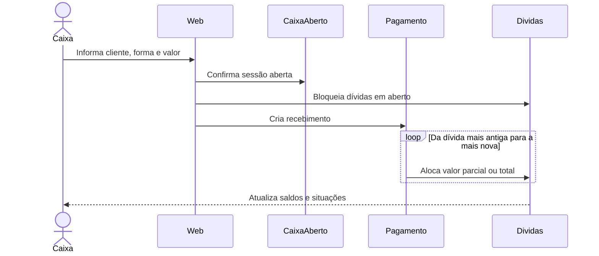
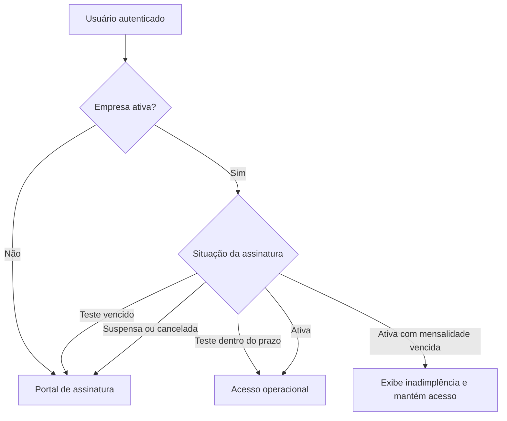
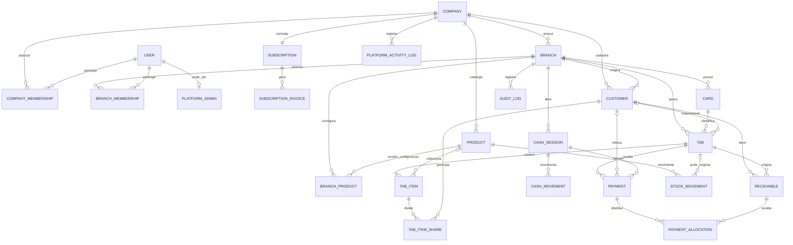

# Arquitetura e funcionalidades do GiraComanda

> Documento técnico e funcional do estado atual da aplicação.
>
> Última revisão: 19 de outubro de 2026.

## 1. Visão executiva

O GiraComanda é uma aplicação web SaaS multiempresa para restaurantes, lanchonetes e cantinas. Seu objetivo é organizar o consumo do cliente desde a identificação de um cartão reutilizável por QR Code até o pagamento imediato ou a criação de uma anotação para pagamento posterior.

O produto combina cinco capacidades centrais:

1. cartão reutilizável com QR Code;
2. comanda com consumo por unidade ou peso;
3. rateio de itens entre pessoas;
4. fiado detalhado e contas a receber;
5. caixa, estoque, relatórios e auditoria no mesmo fluxo operacional.

Tecnicamente, a aplicação é um monólito modular em Laravel. A interface é renderizada no servidor com Blade, recebe interações progressivas em JavaScript e persiste os dados em MySQL ou MariaDB. Empresas e filiais compartilham a mesma aplicação e o mesmo banco, com isolamento lógico por `company_id` e `branch_id`.

### Estado comercial padrão

- teste gratuito: **7 dias**;
- mensalidade padrão para novos cadastros: **R$ 297,00** (anual: **R$ 2.970,00**);
- cobrança atual: controle interno com geração de mensalidades e baixa manual;
- integração automática com Mercado Pago: **ainda não implementada**;
- comprovantes operacionais: **não fiscais**.

Os valores e prazos são configuráveis. Registros já existentes preservam o valor e as datas armazenados na própria assinatura.

## 2. Escopo do sistema

### Incluído atualmente

- página comercial pública;
- cadastro autônomo para teste gratuito;
- autenticação, recuperação de senha e troca obrigatória de senha temporária;
- empresas, filiais e seleção de contexto operacional;
- usuários e perfis de acesso;
- clientes, cartões e QR Codes;
- comandas, produtos por unidade ou peso e rateio de itens;
- pagamento imediato, misto ou anotado;
- contas a receber, pagamentos parciais e extratos mensais;
- abertura, suprimento, sangria, conferência e fechamento de caixa;
- produtos, estoque mínimo e histórico de movimentações;
- relatórios gerenciais e painel operacional;
- auditoria de alterações e operações sensíveis;
- administração da plataforma, assinaturas e mensalidades;
- modo de suporte com acesso controlado à filial;
- backup, cópia externa opcional e restauração;
- termos de uso e política de privacidade.

### Fora do escopo atual

- emissão de NFC-e, NF-e, SAT ou qualquer documento fiscal;
- cobrança recorrente automática por cartão;
- PIX dinâmico individual por mensalidade;
- webhook e conciliação automática do Mercado Pago;
- integração oficial com a API do WhatsApp;
- integração automática com balança;
- aplicativo nativo ou operação offline-first;
- API pública versionada para terceiros.

## 3. Contexto arquitetural



O navegador é o cliente da aplicação. Não existe um frontend desacoplado consumindo uma API: as requisições seguem o modelo web tradicional do Laravel, com sessão, CSRF, validação por formulários, controllers e respostas Blade.

## 4. Stack tecnológica

| Camada | Tecnologia | Papel |
|---|---|---|
| Backend | PHP 8.4+ e Laravel 13.35 | Regras de negócio, autenticação, autorização, persistência e agendamento |
| Persistência | MySQL ou MariaDB | Dados operacionais, sessões, cache e filas configuráveis |
| ORM | Eloquent | Modelos, relacionamentos, escopos de tenant e consultas |
| Interface | Blade | Renderização das páginas no servidor |
| Estilo | Tailwind CSS 4 | Sistema visual responsivo |
| Build | Vite 8 | Compilação de CSS e JavaScript |
| QR Code impresso | endroid/qr-code 6.1 | Geração de QR Code em SVG |
| Leitura pela câmera | `@zxing/browser` 0.1.5 | Decodificação de QR Code no navegador |
| Testes | PHPUnit 12 | Testes unitários e de integração web |
| Deploy atual | Coolify, Railpack, FrankenPHP e Traefik | Publicação do monólito e terminação HTTPS |

## 5. Organização da aplicação

```text
app/
├── Actions/              Regras de negócio transacionais e relatórios
├── Console/Commands/     Backup, restauração, verificação e mensalidades
├── Contracts/            Contratos de exportação e importação do banco
├── Http/
│   ├── Controllers/      Coordenação das requisições web
│   ├── Middleware/       Tenant, papéis, segurança e senha temporária
│   └── Requests/         Autorização e validação dos formulários
├── Models/               Entidades e relacionamentos Eloquent
├── Models/Concerns/      Escopos reutilizáveis de empresa e filial
├── Observers/            Auditoria automática de modelos
├── Providers/            Registro de serviços, observers e limitadores
└── Services/             Exportação e importação MySQL/MariaDB

config/                   Configuração da aplicação, assinatura e backup
database/migrations/      Evolução do esquema relacional
database/seeders/         Dados iniciais e contas administrativas
resources/views/          Páginas Blade por módulo
resources/js/             Scanner, máscaras e interações progressivas
resources/css/            Tema Tailwind e identidade visual
routes/web.php            Rotas públicas, operacionais e da plataforma
routes/console.php        Agendamentos recorrentes
tests/                    Testes unitários e de funcionalidades
```

### Responsabilidade das camadas

- **Controllers:** recebem a requisição, localizam o contexto e delegam a operação.
- **Form Requests:** normalizam, validam e autorizam os dados recebidos.
- **Actions:** concentram operações críticas, transações, bloqueios e cálculos.
- **Models:** representam os dados, relacionamentos, estados e escopos de visibilidade.
- **Views:** apresentam a interface e os documentos de impressão.
- **Observers:** registram automaticamente eventos auditáveis.
- **Commands:** executam rotinas operacionais e administrativas.

## 6. Multiempresa e multifilial

### Modelo de tenancy

O GiraComanda usa banco compartilhado e esquema compartilhado. O isolamento acontece por colunas de contexto:

- `company_id`: delimita a empresa proprietária dos dados;
- `branch_id`: delimita a filial em que a operação ocorreu.

Os traits `BelongsToCurrentCompany` e `BelongsToCurrentBranch` aplicam escopos globais às consultas e preenchem automaticamente o tenant na criação dos registros. O middleware `ResolveBranchContext` determina a filial ativa e registra no container da aplicação:

- `currentCompany`;
- `currentBranch`;
- `currentUserRole`.

Esse contexto é usado pelos modelos, controllers e views durante toda a requisição.

### Compartilhamento entre filiais

- **Clientes:** podem ficar visíveis apenas na filial de origem ou ser compartilhados entre todas as filiais da mesma empresa.
- **Produtos:** o cadastro-base pertence à empresa; preço, ativação, estoque e estoque mínimo pertencem à configuração de cada filial em `branch_products`.
- **Caixa, comandas, cartões, pagamentos, estoque e auditoria:** permanecem vinculados à filial onde a operação aconteceu.
- **Relatórios:** podem consolidar a empresa ou filtrar uma filial específica.

O compartilhamento de clientes amplia a consulta dentro da mesma empresa, sem permitir acesso a dados de outra empresa.

## 7. Papéis e autorização

| Papel | Escopo | Principais permissões |
|---|---|---|
| Administrador da plataforma | Toda a aplicação SaaS | Empresas, assinaturas, mensalidades, backups, redefinição de senha e modo suporte |
| Administrador da empresa / gerente | Empresa e filiais autorizadas | Todos os módulos operacionais, usuários, produtos, estoque, relatórios, auditoria, configurações e filiais |
| Caixa | Filial autorizada | Comandas, clientes, cartões, caixa, recebimentos, contas a receber e fechamento |
| Atendente | Filial autorizada | Ler cartão, abrir comanda, lançar/remover itens e registrar rateio |

A autorização combina:

- autenticação de sessão;
- associação do usuário à empresa e à filial;
- perfil efetivo da filial;
- middleware de papel;
- escopos de tenant nos modelos;
- validações específicas de cada Form Request.

O administrador da plataforma não opera diretamente os dados de uma empresa. Para isso, inicia uma sessão explícita de **modo suporte**, escolhe a filial e deixa um registro no histórico administrativo.

## 8. Módulos funcionais

### 8.1 Site comercial e aquisição

A rota pública principal apresenta a proposta comercial do produto, seus diferenciais, benefícios, preço e chamada para teste gratuito. Também existem páginas públicas de privacidade e termos de uso.

O cadastro do teste cria, em uma única transação:

- empresa;
- filial inicial chamada `Matriz`;
- usuário proprietário;
- associação do proprietário à empresa e à filial;
- configurações iniciais do estabelecimento;
- assinatura em teste.

Após o cadastro, o proprietário é autenticado automaticamente e entra no sistema.

### 8.2 Autenticação e identidade

- login por e-mail e senha;
- logout com invalidação da sessão;
- recuperação de senha por e-mail;
- limitação de tentativas de login e recuperação;
- senha armazenada com hash do Laravel;
- opção de exigir troca de senha temporária antes do acesso;
- sessão persistida conforme a configuração do ambiente.

### 8.3 Empresas e filiais

- cadastro e ativação/desativação de empresas pela plataforma;
- uma empresa pode possuir várias filiais;
- seleção da filial ativa após o login;
- bloqueio da desativação da última filial ativa;
- bloqueio da desativação da filial atualmente selecionada;
- compartilhamento opcional de clientes entre filiais;
- isolamento operacional de caixa, cartões e estoque.

### 8.4 Usuários e permissões

- criação e edição de usuários;
- perfis de administrador, caixa e atendente;
- ativação e desativação de acesso;
- associação à empresa e à filial;
- sincronização do perfil entre o usuário e seus memberships;
- proteção contra o usuário desativar a própria conta;
- redefinição de senha do proprietário pelo administrador da plataforma.

### 8.5 Clientes

- nome, CPF validado, telefone, e-mail e observações;
- limite de crédito opcional;
- dia individual de vencimento;
- ativação ou desativação;
- CPF exclusivo dentro da empresa;
- resumo do histórico de consumo;
- total anotado, total pago, saldo em aberto e crédito disponível;
- visualização das anotações recentes;
- extrato mensal por cliente.

### 8.6 Cartões reutilizáveis e QR Code

- cadastro de cartões por filial;
- código visível e token UUID exclusivo para leitura;
- estados `Disponível`, `Em uso` e `Bloqueado`;
- impressão unitária ou em lote;
- QR Code gerado em SVG;
- espaço para identidade visual do estabelecimento;
- leitura pela câmera traseira do tablet ou celular;
- abertura de nova comanda quando o cartão está disponível;
- recuperação da comanda aberta quando o cartão já está em uso;
- seleção manual como alternativa quando a câmera não está disponível.

A câmera exige contexto seguro HTTPS, exceto nas exceções de desenvolvimento permitidas pelo navegador.

### 8.7 Comandas e consumo

- abertura de comanda vinculada ao cartão;
- prevenção de duas comandas abertas no mesmo cartão;
- lançamento por usuário identificado;
- produtos vendidos por unidade ou por peso;
- quantidade armazenada em milésimos;
- preço e nome copiados para o item no momento da venda;
- cálculo do total da comanda;
- retirada de item enquanto a comanda está aberta;
- devolução automática do estoque ao remover um item;
- consulta de comandas abertas, fechadas e canceladas.

O snapshot do item preserva o histórico mesmo que o produto seja renomeado ou seu preço seja alterado depois da venda.

### 8.8 Rateio por pessoa

Um item da comanda pode ser dividido entre vários clientes. O sistema:

- exclui o rateio anterior antes de recalcular;
- divide o valor em centavos;
- distribui eventual resto de centavos de forma determinística;
- mantém uma única venda e uma única baixa de estoque;
- cria responsabilidades financeiras individuais quando a comanda é anotada.

O rateio não duplica o item, a receita ou a movimentação de estoque.

### 8.9 Fechamento da comanda

As formas disponíveis são:

- dinheiro;
- PIX;
- cartão de débito;
- cartão de crédito;
- pagamento misto;
- anotação na conta do cliente.

Pagamentos imediatos exigem caixa aberto. No pagamento misto, pelo menos duas formas devem ser informadas e a soma precisa corresponder exatamente ao total da comanda.

No fechamento:

- os pagamentos são registrados;
- ou são criadas contas a receber;
- a comanda passa para `Fechada`;
- o usuário responsável e o horário são registrados;
- o cartão volta ao estado `Disponível`;
- um comprovante não fiscal pode ser impresso.

### 8.10 Fiado e contas a receber

Quando a forma escolhida é anotação:

- um cliente responsável é obrigatório;
- itens sem rateio ficam com o cliente principal;
- itens rateados geram valores separados para cada participante;
- o vencimento usa o dia do cliente ou o vencimento geral do estabelecimento;
- o sistema respeita o último dia de meses mais curtos;
- valores ficam associados à comanda e à filial de origem.

O recebimento posterior:

- exige caixa aberto;
- aceita dinheiro, PIX, débito ou crédito;
- pode ser parcial;
- não pode ultrapassar o saldo devido;
- é distribuído das dívidas mais antigas para as mais novas;
- cria alocações que ligam o pagamento a cada anotação;
- marca a anotação como paga quando o saldo chega a zero.

### 8.11 Extrato e fechamento mensal

O extrato mensal calcula:

- saldo anterior;
- novas anotações do período;
- pagamentos do período;
- saldo final;
- consumos e pagamentos detalhados.

O fechamento mensal consolida:

- clientes com movimento ou saldo;
- total anotado;
- total recebido;
- total em aberto;
- valores vencidos e a vencer;
- quantidade de resumos marcados como enviados.

O envio por WhatsApp é assistido: o sistema monta a mensagem e abre um link `wa.me`. Não existe envio automático nem confirmação pela API oficial do WhatsApp. O operador pode marcar o resumo como enviado para manter o histórico.

### 8.12 Caixa

- apenas um caixa aberto por filial;
- valor de abertura;
- suprimentos;
- sangrias;
- recebimentos ligados à sessão;
- detalhamento dos pagamentos;
- valor esperado em dinheiro;
- valor contado no fechamento;
- diferença de caixa;
- observações e responsáveis pela abertura e fechamento.

O valor esperado considera:

```text
abertura + recebimentos em dinheiro + suprimentos - sangrias
```

Pagamentos eletrônicos integram os totais recebidos, mas não aumentam o numerário esperado em espécie.

### 8.13 Produtos e estoque

- catálogo de produtos da empresa;
- venda por unidade ou quilo;
- preço por filial;
- produto ativo ou inativo por filial;
- estoque opcional;
- estoque mínimo opcional;
- saldo inicial;
- entradas;
- saídas manuais;
- ajuste de inventário;
- baixa automática na venda;
- estorno automático ao remover item ou cancelar venda elegível;
- histórico com saldo resultante, usuário, data e origem.

Os cálculos usam milésimos para representar unidades fracionadas e peso, evitando dependência de números de ponto flutuante na persistência.

### 8.14 Cancelamento de comandas

Uma comanda fechada pode ser cancelada pelo administrador da empresa quando:

- os pagamentos relacionados ainda pertencem a um caixa aberto;
- nenhuma anotação recebeu pagamento parcial ou total.

O cancelamento:

- exige motivo;
- remove pagamentos e contas a receber elegíveis;
- devolve o estoque;
- registra usuário e horário;
- mantém a comanda com estado `Cancelada` para rastreabilidade.

Quando o caixa já foi fechado ou a dívida já recebeu pagamento, a correção automática é recusada para evitar alterações retroativas incoerentes.

### 8.15 Relatórios e painel

O relatório gerencial trabalha por período e pode consolidar toda a empresa ou uma filial. Ele apresenta:

- quantidade de comandas fechadas;
- venda bruta;
- ticket médio;
- total recebido;
- total anotado;
- saldo em contas a receber;
- total por forma de pagamento;
- vendas diárias;
- produtos mais vendidos;
- produtos com estoque baixo.

O painel operacional resume o estado atual para apoiar a rotina da filial.

### 8.16 Auditoria

O observer de auditoria acompanha criações, alterações e exclusões nos principais modelos operacionais:

- usuários;
- clientes;
- cartões;
- produtos e estoque;
- caixa;
- comandas e rateios;
- contas a receber;
- pagamentos;
- configurações.

Cada registro pode conter usuário, filial, área, evento, entidade afetada, campos alterados, descrição, data e endereço IP. Senhas, tokens de sessão e tokens de QR Code não são registrados como campos alterados.

Há um histórico administrativo separado para ações da plataforma, como criação de empresa, alteração de assinatura, baixa de mensalidade, redefinição de senha e início ou término do modo suporte.

### 8.17 Administração da plataforma SaaS

O painel da plataforma permite:

- visualizar indicadores gerais;
- listar empresas, filiais, responsáveis e assinaturas;
- cadastrar empresa e proprietário;
- ativar ou desativar a empresa inteira;
- alterar status, valor, vencimento e período de teste;
- criar mensalidades manualmente;
- registrar pagamentos e reativar o acesso;
- redefinir a senha do proprietário;
- entrar em uma filial pelo modo suporte;
- criar e baixar backups.

### 8.18 Assinatura e cobrança

Assinaturas possuem os estados:

- `Em teste`;
- `Ativa`;
- `Suspensa`;
- `Cancelada`.

Regras atuais:

- o teste permanece acessível até a data final, inclusive;
- teste vencido perde acesso às filiais e é direcionado ao portal de assinatura;
- assinatura ativa permite acesso;
- assinatura suspensa ou cancelada bloqueia o acesso operacional;
- mensalidade vencida muda a apresentação para `Inadimplente`, mas não suspende automaticamente uma assinatura ativa;
- o administrador da plataforma sempre mantém controle manual sobre status e liberação.

Para assinaturas ativas, o comando `subscriptions:sync-invoices` gera uma mensalidade por mês, conforme o dia de vencimento e o valor da assinatura. Mensalidades automáticas ainda não pagas são atualizadas quando valor ou vencimento mudam.

O pagamento da mensalidade é aceito inicialmente apenas por PIX e pode ser baixado manualmente com a data da confirmação. A baixa pode reativar o acesso. Hoje a página de assinatura pode exibir:

- chave PIX configurada;
- QR Code gerado a partir do PIX copia e cola;
- link de suporte por WhatsApp.

Esses dados são configurações estáticas. Não representam integração com um gateway.

### 8.19 Backup e restauração

- backup lógico com `mysqldump`;
- transação consistente e sem bloqueio global de tabelas;
- armazenamento privado;
- cópia opcional para disco externo, NAS ou pasta sincronizada;
- retenção por quantidade máxima e idade;
- geração manual pelo painel ou pelo comando;
- execução diária pelo agendador;
- restauração por comando, com validação do nome do arquivo;
- aplicação colocada em manutenção durante a importação;
- reativação garantida mesmo quando a restauração falha.

## 9. Fluxos críticos

### 9.1 Cadastro do teste gratuito



### 9.2 Cartão, comanda e consumo



### 9.3 Fechamento e destino financeiro



### 9.4 Recebimento de dívida



### 9.5 Assinatura e acesso



## 10. Modelo de dados

### Visão relacional simplificada



### Agregados principais

| Agregado | Entidades | Responsabilidade |
|---|---|---|
| Tenant | `Company`, `Branch`, memberships | Isolamento, filiais e acesso |
| Operação | `Card`, `Tab`, `TabItem`, `TabItemShare` | Identificação e consumo |
| Catálogo/estoque | `Product`, `BranchProduct`, `StockMovement` | Preço, disponibilidade e saldo por filial |
| Cliente/fiado | `Customer`, `Receivable`, `PaymentAllocation` | Crédito, dívida e quitação |
| Caixa | `CashSession`, `CashMovement`, `Payment` | Disponibilidade financeira da sessão |
| SaaS | `Subscription`, `SubscriptionInvoice` | Acesso da empresa e cobrança do software |
| Governança | `AuditLog`, `PlatformActivityLog` | Rastreabilidade operacional e administrativa |

### Convenções de persistência

- valores monetários são inteiros em centavos (`*_cents`);
- quantidades e pesos são inteiros em milésimos (`*_milliunits`);
- horários operacionais são gravados como timestamps;
- competências mensais são armazenadas como datas normalizadas;
- estados de negócio são strings convertidas para enums PHP;
- chaves estrangeiras preservam integridade e evitam exclusões perigosas;
- itens de comanda mantêm snapshot de nome, tipo e preço.

## 11. Consistência, concorrência e transações

As operações que alteram mais de um agregado usam transações de banco. Os pontos de maior risco também usam `lockForUpdate` ou trava de cache:

- abertura de comanda e reserva do cartão;
- lançamento e retirada de itens;
- baixa e estorno de estoque;
- rateio;
- fechamento e cancelamento de comanda;
- recebimento e alocação de pagamentos;
- fechamento de caixa;
- criação completa de uma empresa;
- prevenção de dois caixas abertos simultaneamente.

Essas travas protegem contra duplicidade, estoque negativo, dupla utilização de cartão e alocações financeiras inconsistentes quando vários operadores trabalham ao mesmo tempo.

## 12. Segurança

### Controles implementados

- autenticação e sessão do Laravel;
- proteção CSRF em formulários web;
- senhas com hash;
- limitação de tentativas de login, recuperação e cadastro de teste;
- autorização por papel e tenant;
- escopos globais de empresa e filial;
- validação de entrada em Form Requests;
- cabeçalhos `X-Content-Type-Options`, `X-Frame-Options` e `Referrer-Policy`;
- política de permissões que permite somente a câmera da própria origem;
- HSTS em conexões HTTPS;
- cookies seguros e sessões criptografadas quando configurados em produção;
- arquivos de backup em armazenamento privado;
- `.env` fora do controle de versão;
- modo suporte explícito e auditado;
- verificação de prontidão para produção.

### Dependências de operação segura

- HTTPS deve estar ativo em produção;
- o proxy reverso precisa encaminhar corretamente o protocolo;
- o servidor web deve publicar apenas `public/`;
- credenciais e chaves devem ser fornecidas por variáveis de ambiente;
- o agendador do Laravel precisa executar continuamente;
- backups devem ser copiados e testados fora do servidor principal.

## 13. Rotinas agendadas e comandos

| Rotina | Horário | Finalidade |
|---|---:|---|
| `subscriptions:sync-invoices` | 00:10 diariamente | Criar ou atualizar mensalidades automáticas de assinaturas ativas |
| `backup:database` | 02:00 diariamente | Gerar backup e aplicar retenção |

Outros comandos importantes:

| Comando | Finalidade |
|---|---|
| `app:production-check` | Validar configurações mínimas antes da publicação |
| `backup:database` | Criar backup manual |
| `backup:restore <arquivo> --force` | Restaurar um backup existente |
| `subscriptions:sync-invoices` | Sincronizar mensalidades manualmente |

Para que os horários funcionem, o ambiente precisa executar `php artisan schedule:run` a cada minuto ou manter `php artisan schedule:work` sob supervisão.

## 14. Configurações relevantes

### Assinatura

| Variável | Uso | Padrão |
|---|---|---:|
| `SUBSCRIPTION_MONTHLY_AMOUNT_CENTS` | Valor inicial da mensalidade | `29700` |
| `SUBSCRIPTION_TRIAL_DAYS` | Duração do teste | `7` |
| `SUBSCRIPTION_PIX_KEY` | Chave PIX exibida no portal | vazio |
| `SUBSCRIPTION_PIX_COPY_PASTE` | Payload PIX usado para copiar e gerar o QR Code | vazio |
| `SUBSCRIPTION_SUPPORT_WHATSAPP` | Número de suporte | vazio |

### Backup

| Variável | Uso |
|---|---|
| `BACKUP_DISK` | Disco principal do backup |
| `BACKUP_EXTERNAL_DISK` | Segunda cópia opcional |
| `BACKUP_DIRECTORY` | Diretório dos arquivos SQL |
| `BACKUP_RETENTION_DAYS` | Retenção por idade |
| `BACKUP_MAXIMUM_FILES` | Limite de arquivos |
| `MYSQL_DUMP_BINARY` | Caminho do `mysqldump` |
| `MYSQL_BINARY` | Caminho do cliente `mysql` |

### Ambiente e operação

- `APP_ENV`, `APP_DEBUG`, `APP_URL`;
- conexão MySQL/MariaDB;
- sessão e cache;
- SMTP para recuperação de senha;
- configuração do proxy e HTTPS;
- disco público para logos e disco privado para backups.

## 15. Observabilidade e suporte

Atualmente a observabilidade é baseada em:

- logs do Laravel;
- auditoria operacional em banco;
- histórico administrativo da plataforma;
- páginas de dashboard e relatórios;
- endpoint de saúde `/up`;
- comando de verificação de produção;
- informações de erro registradas no backend.

Não há, no código atual, integração dedicada com APM, rastreamento distribuído ou serviço externo de alertas.

## 16. Testes e qualidade

A suíte cobre os principais comportamentos:

- autenticação e redefinição de senha;
- cadastro do teste gratuito;
- isolamento entre empresas e filiais;
- contexto e troca de filial;
- comandas, itens, rateio e cancelamento;
- cartões e leitura de QR Code;
- caixa e movimentos;
- contas a receber e pagamentos parciais;
- estoque;
- relatórios e fechamento mensal;
- auditoria;
- assinaturas e painel da plataforma;
- backup e restauração;
- cabeçalhos de segurança e verificação de produção.

Além dos testes automatizados, a validação real deve incluir câmera, tablet, impressora, HTTPS, e-mail, banco de produção, backup externo e restauração em ambiente separado.

## 17. Decisões arquiteturais importantes

### Monólito modular

Foi escolhido para reduzir complexidade operacional e manter transações fortes entre venda, caixa, estoque e contas a receber. É adequado ao estágio atual do produto e ao volume esperado do piloto.

### Banco compartilhado com escopos de tenant

Simplifica implantação, relatórios da plataforma e manutenção. Em contrapartida, exige disciplina permanente em consultas, rotas, testes de isolamento e operações que removem escopos globais.

### Dinheiro em centavos e quantidade em milésimos

Evita erros de arredondamento comuns em valores monetários e atende tanto unidades quanto produtos vendidos por peso.

### Snapshot dos itens vendidos

Preserva o histórico financeiro mesmo quando o cadastro do produto muda.

### Actions para regras críticas

Mantém controllers pequenos e permite reunir transação, travas e invariantes no mesmo ponto.

### Cobrança do SaaS separada da operação do restaurante

`SubscriptionInvoice` controla o que a empresa paga pelo GiraComanda. `Receivable` controla o que os clientes do restaurante devem ao estabelecimento. Os dois fluxos não compartilham pagamentos nem saldos.

### Controle manual preservado

Mesmo após uma integração futura com gateway, o painel da plataforma deve continuar permitindo baixa, reativação, suspensão e correção manual auditada.

## 18. Limites e riscos conhecidos

### Funcionais

- comandas são comprovantes não fiscais;
- WhatsApp depende da ação do operador;
- não há balança integrada;
- correção de venda com caixa fechado exige procedimento administrativo;
- anotação parcialmente paga não pode ser cancelada automaticamente;
- inadimplência da assinatura não bloqueia automaticamente uma empresa ativa.

### Arquiteturais

- a aplicação depende de conexão com o servidor;
- não existe fila dedicada configurada para integrações externas críticas;
- uma futura integração de pagamentos exigirá idempotência e validação de webhook;
- remoção deliberada dos escopos de tenant em relatórios precisa continuar cercada por filtros de empresa;
- backup lógico depende da disponibilidade dos binários do MySQL/MariaDB;
- o agendador é responsabilidade da infraestrutura.

### Estado da cobrança

Não se deve comunicar a cobrança atual como integrada. Para considerar o Mercado Pago concluído ainda serão necessários, no mínimo:

1. credenciais e configuração por ambiente;
2. criação de preferência, pagamento ou assinatura no provedor;
3. identificação do cliente e da mensalidade no gateway;
4. validação de assinatura do webhook;
5. idempotência no processamento;
6. conciliação de pago, pendente, recusado, estornado e reembolsado;
7. política de tolerância e bloqueio por atraso;
8. reativação automática sem remover o controle manual;
9. testes de sandbox e produção.

## 19. Evoluções recomendadas

### Prioridade comercial

1. integrar checkout ou assinatura do Mercado Pago;
2. adicionar webhooks e conciliação automática;
3. definir tolerância de atraso e regra de suspensão;
4. automatizar lembretes de vencimento;
5. registrar métricas de conversão do teste gratuito.

### Prioridade operacional

1. homologar impressão em equipamentos reais;
2. testar operação concorrente em tablets;
3. executar restauração periódica em ambiente separado;
4. adicionar monitoramento externo do endpoint `/up`;
5. revisar retenção, privacidade e exportação de dados de clientes.

### Prioridade de produto

1. observar o uso real do piloto;
2. reduzir passos na abertura e no fechamento da comanda;
3. avaliar integração com balança;
4. avaliar PWA ou estratégia offline apenas se a operação demonstrar essa necessidade;
5. planejar integração fiscal como módulo separado, caso entre no escopo comercial.

## 20. Critérios de aceite arquitetural

- uma empresa nunca consulta dados de outra;
- uma filial não mistura caixa, cartões ou estoque com outra filial;
- compartilhamento de clientes ocorre somente dentro da empresa;
- uma venda gera uma única receita e uma única baixa de estoque;
- rateio altera a responsabilidade financeira, não a quantidade vendida;
- pagamento de dívida é rastreável até cada anotação;
- fechamento de caixa apresenta valor esperado, contado e diferença;
- cancelamento elegível estorna valores e estoque na mesma transação;
- toda operação sensível registra usuário e contexto;
- teste vencido, assinatura suspensa ou cancelada bloqueiam o acesso operacional;
- a plataforma consegue reativar manualmente uma empresa;
- backup é criado, copiado e restaurado com sucesso em ambiente de teste;
- o sistema retorna após reinício sem intervenção manual;
- câmera funciona por HTTPS no dispositivo homologado.

## 21. Glossário

| Termo | Significado |
|---|---|
| Comanda | Registro do consumo associado a um cartão |
| Cartão | Identificador físico reutilizável com QR Code |
| Rateio | Divisão financeira de um item entre clientes |
| Anotação / fiado | Valor devido pelo cliente ao estabelecimento |
| Conta a receber | Registro financeiro criado por uma anotação |
| Alocação | Parte de um pagamento aplicada a uma conta a receber |
| Sessão de caixa | Período entre abertura e fechamento do caixa |
| Suprimento | Entrada manual de dinheiro no caixa |
| Sangria | Retirada manual de dinheiro do caixa |
| Tenant | Empresa cujos dados são isolados no sistema |
| Filial ativa | Unidade selecionada para a operação atual |
| Mensalidade | Cobrança da empresa pelo uso do GiraComanda |
| Modo suporte | Acesso auditado da plataforma a uma filial |

## 22. Fonte de verdade deste documento

Este documento descreve o código presente no repositório `restaurante-app` em 19 de outubro de 2026. A referência Git base é o commit `f6db3b3a8714a1fd2dcdcab757ab61ff046ea14c`, somada às alterações locais ainda não commitadas da página comercial, teste gratuito, portal de assinatura e gestão de acesso.

Quando houver divergência entre este documento e o comportamento atual, prevalecem, nesta ordem:

1. regras transacionais em `app/Actions`;
2. autorização e contexto em `app/Http/Middleware` e `app/Http/Requests`;
3. modelos e migrations;
4. rotas e controllers;
5. testes automatizados;
6. documentação.

O documento deve ser atualizado sempre que mudar uma regra financeira, o modelo de tenant, os papéis de acesso, o fluxo de assinatura ou uma integração externa.
